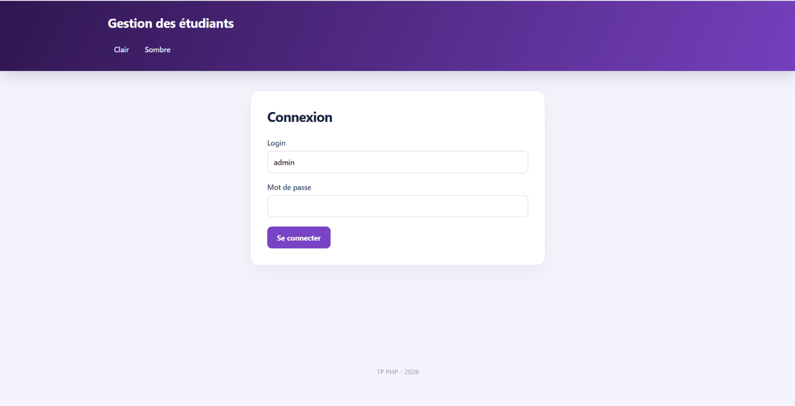
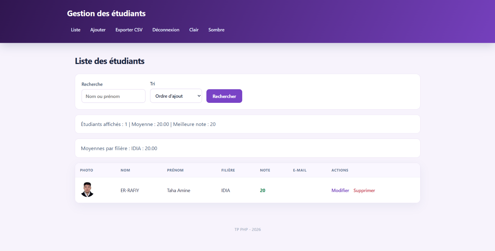
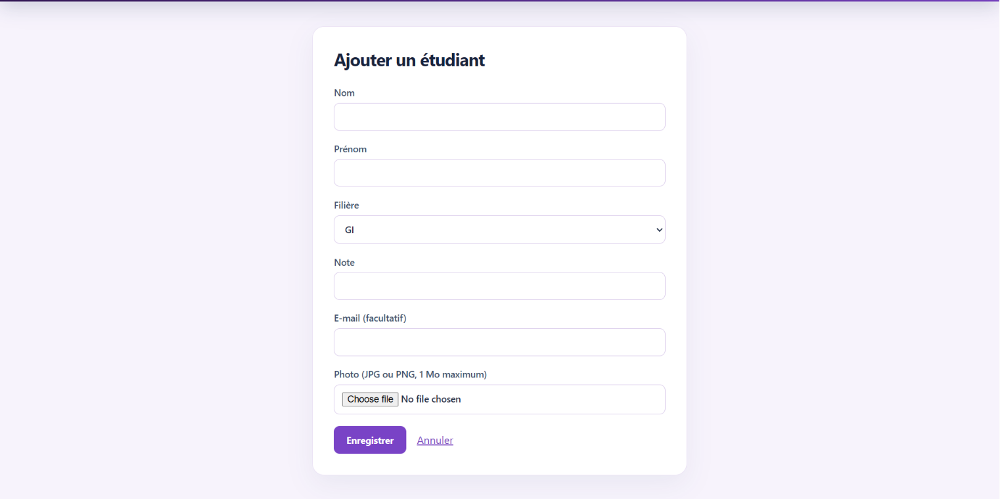

# Gestion des étudiants

Application web développée en PHP dans le cadre d’un TP. Elle permet de gérer une liste d’étudiants enregistrée dans un fichier texte.

## Fonctionnalités

- Connexion et déconnexion avec une session, et mémorisation du dernier login.
- Ajout, modification et suppression d’étudiants avec photo facultative.
- Recherche, tri et affichage des statistiques sur les notes.
- Export de la liste au format CSV et choix d’un thème clair ou sombre.

## Structure du projet

```text
src/            Code PHP, CSS et JavaScript de l’application
  data/         Emplacement du fichier texte des étudiants
  uploads/      Emplacement des photos envoyées
captures/       Captures d’écran de l’application
```

## Installation avec XAMPP

1. Copier le contenu du dossier `src` dans `C:\xampp\htdocs\gestion_etudiants`.
2. Créer un fichier vide `data/etudiants.txt` dans ce dossier.
3. Démarrer Apache depuis XAMPP.
4. Ouvrir `http://localhost/gestion_etudiants/`. Si Apache utilise le port 8080, ouvrir `http://localhost:8080/gestion_etudiants/`.
5. Se connecter avec le login **admin** et le mot de passe **1234**.

Le serveur doit pouvoir écrire dans `data/` et `uploads/`. Les données et les photos locales ne sont pas suivies par Git. Le compte et le stockage sont simplifiés pour un TP local.

## Captures d’écran

### Connexion



### Liste des étudiants



### Ajout d’un étudiant


